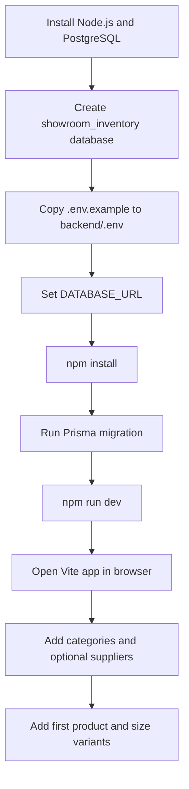
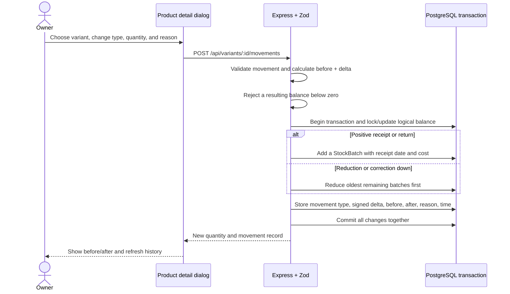

# Project Steps, Decisions, and Operating Flow

This guide records how the showroom inventory application was built and explains its day-to-day flow in plain language.

## 1. What was done

1. Checked the supplied working directory. It was a home directory rather than a Git repository.
2. Located nearby projects and inspected the two plausible web projects. The existing portfolio and finance stock-alerting application did not represent clothing inventory. The stock-alerting repository also had uncommitted changes.
3. Created a new, independent project at `Desktop/vs/showroom-inventory` so those unrelated projects and their changes stay untouched.
4. Set up a small npm workspace with a React + TypeScript + Vite browser application and an Express + TypeScript API.
5. Designed a PostgreSQL schema around product designs, variants, categories, suppliers, receipt batches, and stock movements.
6. Added the initial Prisma schema and SQL migration, Zod API validation, database transaction handling, and the `/api/health` endpoint.
7. Built dashboard, inventory search/filter/sort, product add/detail/edit/archive, stock management/history, old-stock, category, and supplier screens.
8. Added CSV inventory export and tests for stock arithmetic and status classification.
9. Wrote setup and operating instructions. No demo inventory was added, so displayed data comes from the database.

## 2. Decisions and reasons

| Decision | Reason |
| --- | --- |
| New folder under `Desktop/vs` | The current directory did not identify a project repository, and the existing nearby apps were unrelated. This keeps the showroom app isolated. |
| React, TypeScript, and Vite | They match the requested browser stack and provide a quick local development loop with typed components. |
| Express with TypeScript | A small REST API is enough for this single application; separate services or queues would add operational work without helping this workflow. |
| PostgreSQL with Prisma | Relational constraints fit products, variants, suppliers, batches, and history. Prisma keeps database access typed and supports transactions. |
| Zod at the API boundary | The server must reject invalid values even when browser validation is bypassed. |
| Integer paise for money | Integer storage avoids floating point rounding when values are calculated. The UI presents rupees. |
| Product and variant split | A design can have many independently counted sizes and colours, each with its own SKU and price. |
| Separate receipt batches | Each delivery can keep its own date and cost. An old delivery stays old when fresh pieces arrive under the same design. |
| Movement ledger plus current quantity | The quantity makes common lists fast; the ledger explains every change and the transaction keeps both in step. |
| Archive instead of delete | Historical movement records must keep their product and variant references. |
| No seeded inventory | The owner must see only actual entered data. Empty state helps with the first setup. |
| No sales-age language | Phase 1 does not record sales. Old stock is therefore calculated from receipt batches and labelled as stock age. |
| No public authentication in this phase | Authentication was not part of the working MVP implementation. The app is documented as local/trusted-network use only until login and authorization exist. |
| CSV export first | Export is useful and read-only. Import requires preview, row-level validation, duplicate detection, and safeguards against overwriting physical stock. |

## 3. Folder map

```text
showroom-inventory/
├── backend/
│   ├── prisma/schema.prisma              Database entities and relations
│   ├── prisma/migrations/.../migration.sql Initial PostgreSQL migration
│   └── src/
│       ├── app.ts                         Express configuration and errors
│       ├── db.ts                          Prisma client
│       ├── index.ts                       API process entry point
│       ├── rules.ts                       Stock arithmetic and status rules
│       ├── rules.test.ts                  Business rule tests
│       └── routes/inventory.ts            Validated inventory REST endpoints
├── frontend/
│   └── src/
│       ├── App.tsx                        Navigation, screens, forms and API calls
│       ├── main.tsx                       React entry point
│       └── styles.css                     Responsive visual system
├── docs/PROJECT_FLOW.md                  This implementation and workflow guide
├── .env.example                          Safe environment-variable template
└── README.md                              Setup, commands, API, backup and limits
```

## 4. Starting the project for the first time



### Step-by-step explanation

1. **Install prerequisites.** Node runs the web tooling and API. PostgreSQL stores the actual showroom records.
2. **Create the database.** This gives the app a dedicated place for its tables.
3. **Configure the connection.** `backend/.env` contains the private connection string. It is ignored by Git.
4. **Install dependencies.** The root package starts the two application packages together.
5. **Apply migration.** Prisma runs the checked-in SQL migration to create tables, constraints, and indexes.
6. **Start both processes.** Vite serves the browser app on port 5173. Express serves JSON on port 4000. Vite forwards `/api` calls during local development.
7. **Set up store vocabulary.** Create the categories the shop actually uses. Add suppliers if useful; supplier selection is optional on a product.
8. **Enter a design.** Add a name/code/category and one or more size/colour rows with quantities and prices.
9. **Verify the result.** The dashboard and product page immediately read the saved rows from PostgreSQL.

The checked-in automated tests cover the pure stock rules. They do not yet exercise REST routes against PostgreSQL or simulate database transaction failures; those need a configured test database before production use.

## 5. Product creation flow

```mermaid
sequenceDiagram
  actor Owner
  participant UI as React form
  participant API as Express + Zod
  participant DB as PostgreSQL via Prisma
  Owner->>UI: Enter design details and variant rows
  UI->>API: POST /api/products
  API->>API: Validate required fields, quantities, prices, and unique rows
  API->>DB: Begin transaction; create Product and Variants
  loop Each variant with opening quantity above zero
    API->>DB: Create opening StockBatch with receipt date and cost
    API->>DB: Create OPENING InventoryMovement
  end
  API->>DB: Commit transaction
  API-->>UI: Product plus variants
  UI-->>Owner: Show saved product and confirmation
```

The database enforces product-code and variant-SKU uniqueness. If any variant row fails or a code already exists, the creation transaction does not leave a partial product behind.

## 6. Stock adjustment flow



If the request fails, Prisma rolls back the transaction. The browser displays an error and does not claim the change succeeded. The owner must give a reason for every adjustment.

## 7. How dashboard and old stock figures are derived

- **Design count** counts active `Product` records.
- **Pieces in stock** sums each active variant's current quantity.
- **Inventory value** multiplies known remaining batch quantity by its stored unit cost. The dashboard also counts variants with any remaining pieces whose cost is missing, so a partial value is not presented as complete.
- **Low stock** means quantity is greater than zero and at or below that variant's reorder threshold. **Out of stock** means quantity is zero.
- **Old stock** checks each remaining batch's receipt date against the selected age. It reports batch age only; it cannot say when a design last sold.
- **Movement history** comes from `InventoryMovement`, ordered newest first. The ledger is not deleted when a product is archived.

## 8. Operational and security boundary

The current implementation has no login, user attribution, external photo storage, scheduled backup, public hosting configuration, or CSV import. The API binds to loopback and should stay on the local machine. Before a public deployment or multi-user use, add authentication and authorization, HTTPS, user identity on movements, tested automated backups, and a deployment-specific security review. See the root README for backup and restore command guidance.
